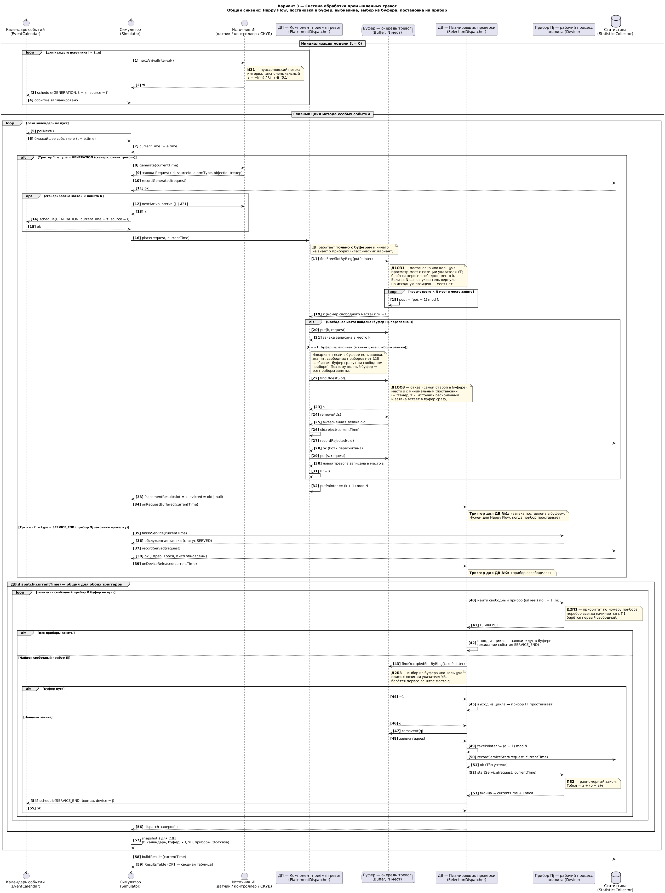
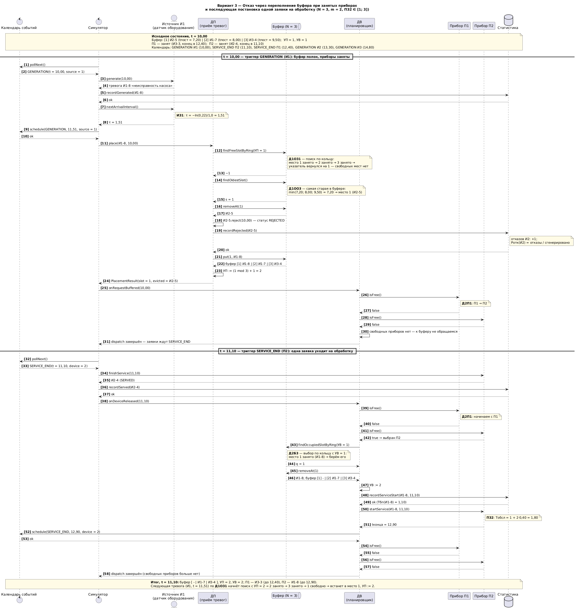
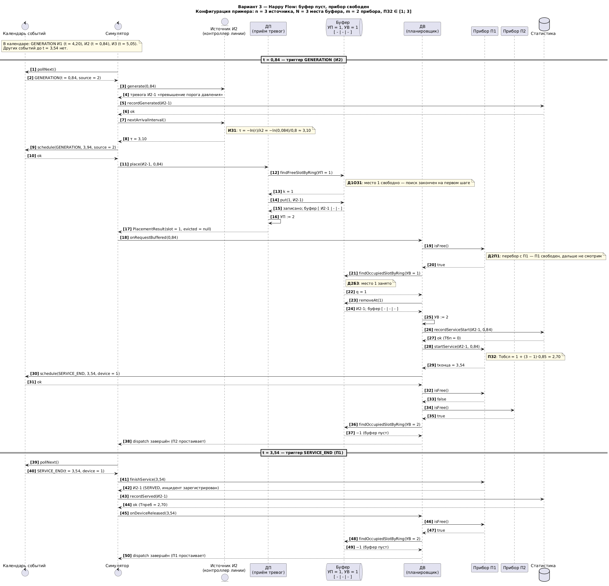
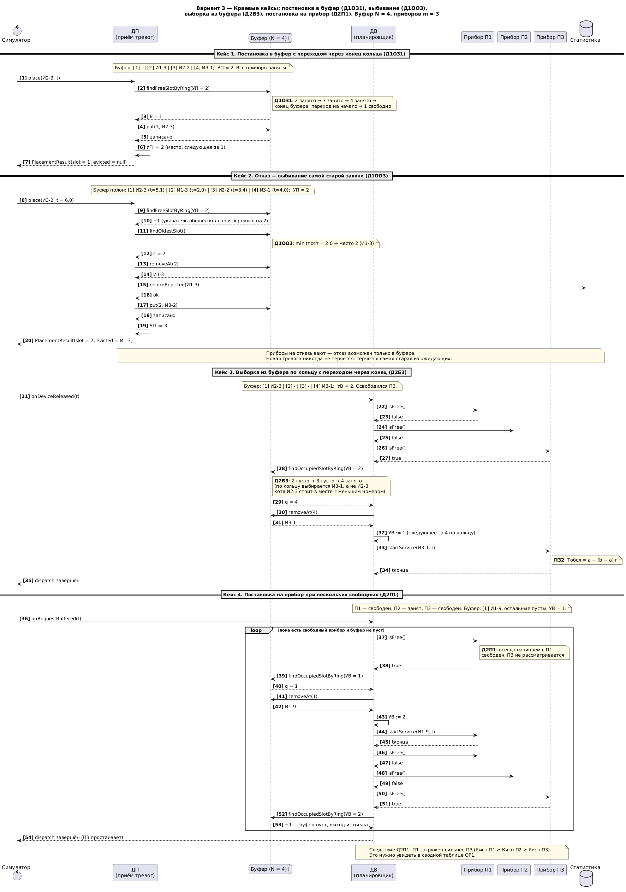
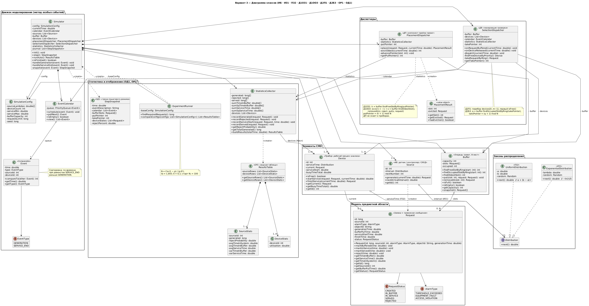
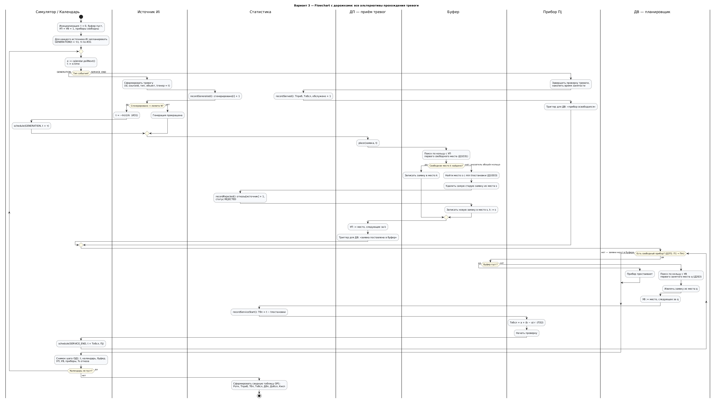

# Система массового обслуживания - Вариант 3
### Мазитов Владислав Евгеньевич, 5130904/40106

**Бизнес-домен:** система оперативной обработки тревог промышленного объекта.

`ИБ | ИЗ1 | ПЗ2 | Д1ОЗ1 | Д1ОО3 | Д2П1 | Д2Б3 | ОР1 | ОД1`

[Описание бизнес-домена (PDF)](docs/Бизнес-домен_Вариант_3.pdf) , [Маппинг (PDF)](docs/Маппинг_Вариант_3.pdf)

## Артефакт 1. Сиквенс-диаграммы
**1.1. Общий сиквенс** со всеми альтернативами и циклами ожидания: Happy Flow, постановка в буфер, выбивание, выбор из буфера, постановка на прибор.

**1.2. Отказ через переполнение буфера при занятых приборах с последующей постановкой одной заявки на обработку** (сценарий на конкретных числах).

**1.3. Happy Flow:** буфер свободен, прибор свободен.

**1.4. Краевые кейсы:** переход указателя через конец кольца (Д1ОЗ1, Д2Б3), выбивание (Д1ОО3), выбор прибора при нескольких свободных (Д2П1).

## Артефакт 2. Диаграмма классов

## Артефакт 3. Flowchart с дорожками

