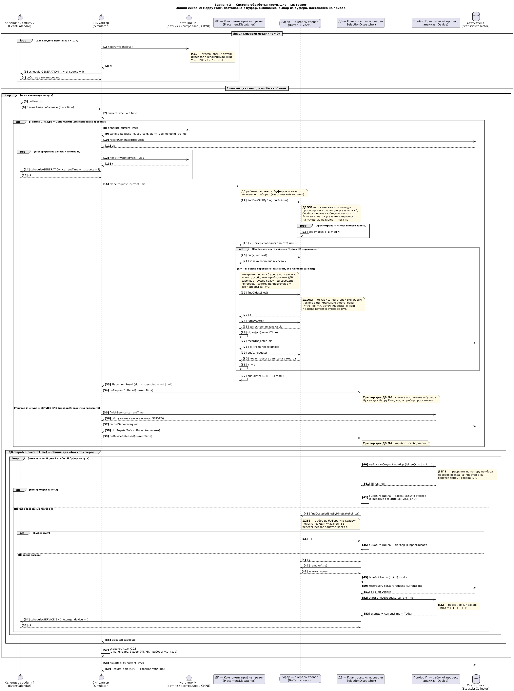
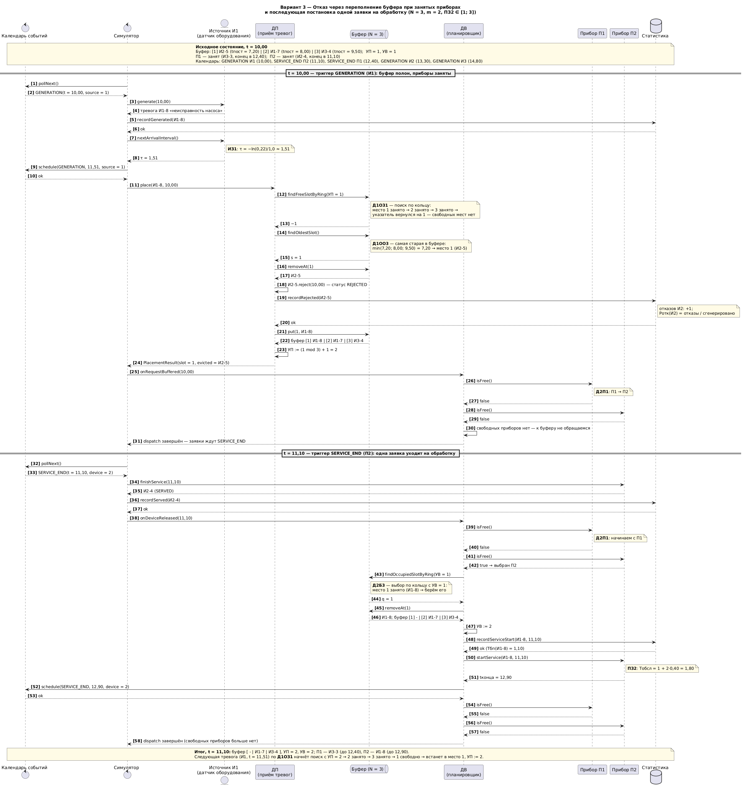
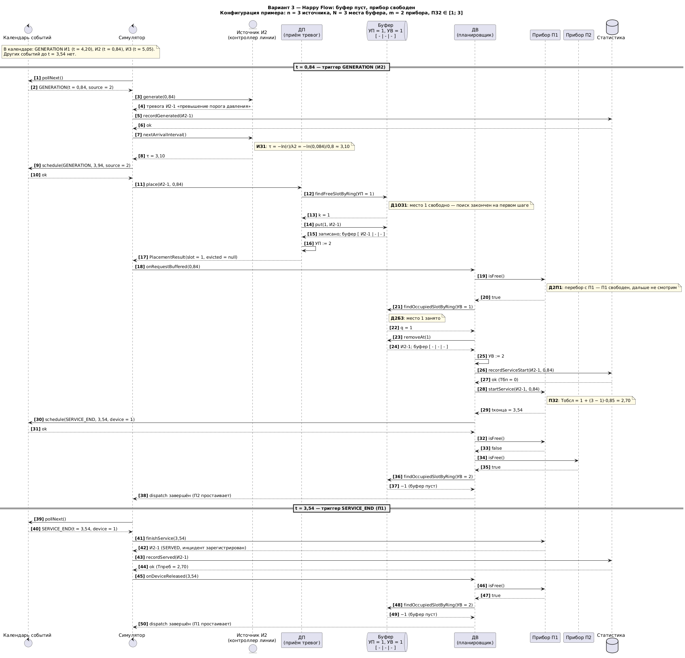
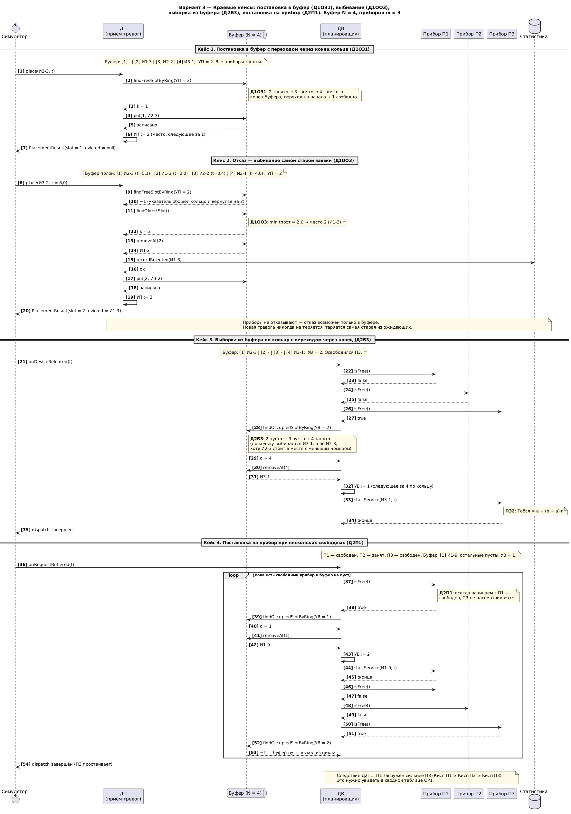
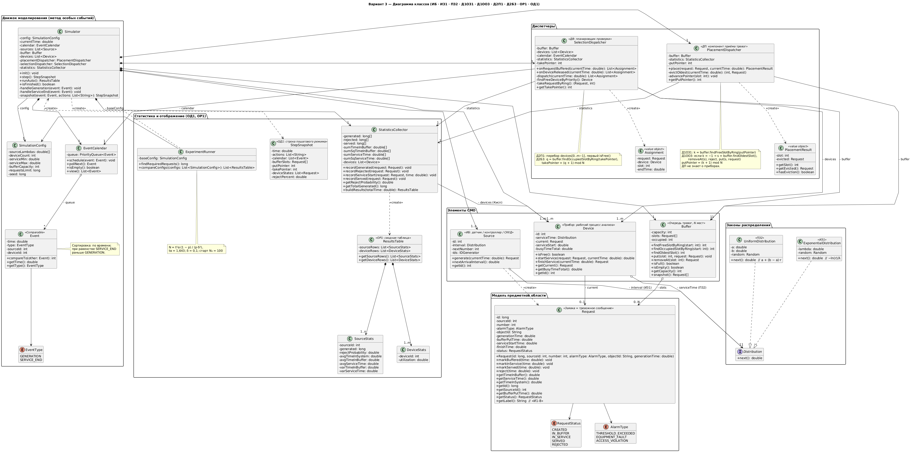
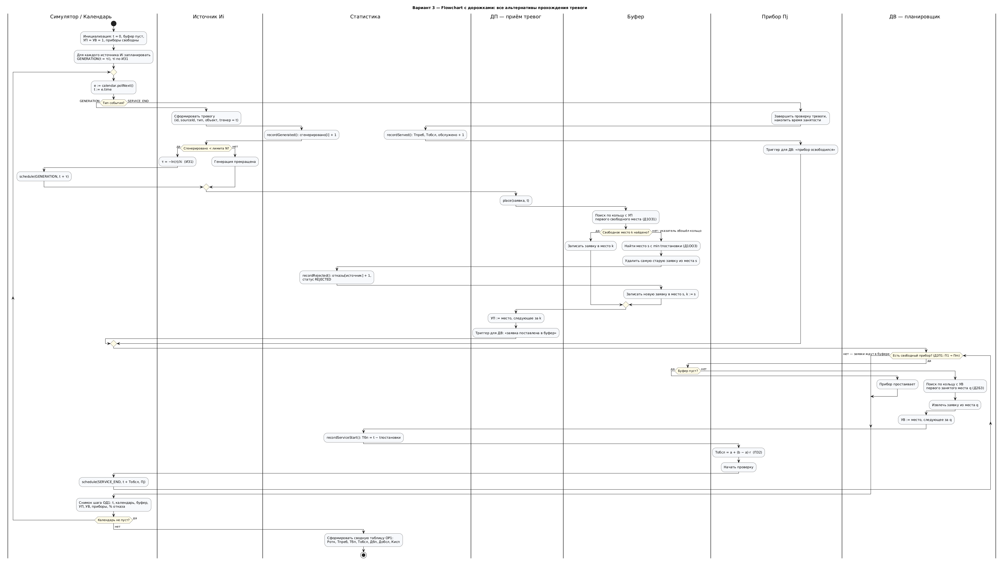
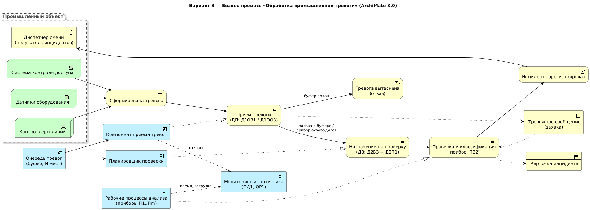

# Система массового обслуживания — Вариант 3
### ФИО, группа

**Бизнес-домен:** система оперативной обработки тревог промышленного объекта.
Датчики оборудования, контроллеры технологических линий и система контроля доступа (СКУД) формируют тревожные сообщения. Сообщения попадают в общую ограниченную очередь, откуда рабочие процессы анализа забирают их на проверку, классификацию и регистрацию инцидента. При переполнении очереди вытесняется самая старая тревога: свежие сообщения важнее устаревших.

`ИБ | ИЗ1 | ПЗ2 | Д1ОЗ1 | Д1ОО3 | Д2П1 | Д2Б3 | ОР1 | ОД1`

## Расшифровка варианта

| Код | Значение | Как реализуется |
|---|---|---|
| **ИБ** | Бесконечные источники | `Source` после каждой генерации планирует следующую: событие `GENERATION` в календаре |
| **ИЗ1** | Пуассоновский поток (экспоненциальные интервалы) | `ExponentialDistribution.next()`: τ = −ln(r)/λᵢ, r ∈ (0;1) |
| **ПЗ2** | Равномерное время обслуживания | `UniformDistribution.next()`: Тобсл = a + (b − a)·r |
| **Д1ОЗ1** | Постановка в буфер «по кольцу» | `PlacementDispatcher`: поиск свободного места с указателя постановки УП, затем УП := следующее за занятым |
| **Д1ОО3** | Отказ: самая старая в буфере | при полном буфере вытесняется заявка с минимальным `bufferPutTime`, новая встаёт на её место |
| **Д2П1** | Выбор прибора по приоритету номера | `SelectionDispatcher`: перебор П1 → Пm, берётся первый свободный |
| **Д2Б3** | Выбор из буфера «по кольцу» | поиск занятого места с указателя выбора УВ, затем УВ := следующее за выбранным |
| **ОД1** | Пошаговый режим: календарь событий, буфер, текущее состояние | `StepSnapshot` на каждом особом событии |
| **ОР1** | Автоматический режим: сводная таблица | `ResultsTable` (графики по варианту не нужны) |

## Маппинг СМО → бизнес-домен

| Элемент СМО | Сущность домена | Класс |
|---|---|---|
| Источник | Датчик / контроллер линии / СКУД | `Source` |
| Заявка | Тревожное сообщение | `Request` |
| Буфер | Ограниченная очередь тревог | `Buffer` |
| Прибор | Рабочий процесс анализа тревог | `Device` |
| ДП | Компонент приёма тревог | `PlacementDispatcher` |
| ДВ | Планировщик проверки тревог | `SelectionDispatcher` |
| Отказ | Удаление тревоги без проверки | `Request.reject()` + `StatisticsCollector.recordRejected()` |

[Описание бизнес-домена (PDF)](docs/Бизнес-домен_Вариант_3.pdf) · [Маппинг (PDF)](docs/Маппинг_Вариант_3.pdf)

## Артефакт 1. Сиквенс-диаграммы
**1.1. Общий сиквенс** со всеми альтернативами и циклами ожидания: Happy Flow, постановка в буфер, выбивание, выбор из буфера, постановка на прибор.


**1.2. Отказ через переполнение буфера при занятых приборах с последующей постановкой одной заявки на обработку** (сценарий на конкретных числах).


**1.3. Happy Flow:** буфер свободен, прибор свободен.


**1.4. Краевые кейсы:** переход указателя через конец кольца (Д1ОЗ1, Д2Б3), выбивание (Д1ОО3), выбор прибора при нескольких свободных (Д2П1).


## Артефакт 2. Диаграмма классов


## Артефакт 3. Flowchart с дорожками


## Артефакт 4 (опционально). Бизнес-процесс в ArchiMate 3.0


---

## Программа (Go)

Требуется Go 1.21+. Внешних зависимостей нет.

```bash
go test ./...                      # тесты: сценарии с сиквенс-диаграмм на тех же числах
go run ./cmd/smo -mode step        # пошаговый режим ОД1 (Enter — шаг, a — до конца, q — выход)
go run ./cmd/smo -mode step -steps 10   # первые 10 шагов без интерактива
go run ./cmd/smo -mode auto        # автоматический режим ОР1 с подбором N
go run ./cmd/smo -mode experiment  # перебор конфигураций для экономического обоснования
```

Параметры: `-lambdas 1.0,0.8,0.6` (λ источников, ИЗ1), `-devices 3` (m), `-a 0.5 -b 1.5` (ПЗ2), `-buffer 5` (N мест), `-n 1000` (число заявок), `-seed 42`, `-device-cost 10 -reject-cost 50` (стоимости для режима experiment).

### Соответствие кода диаграмме классов

| Пакет | Классы с диаграммы |
|---|---|
| `internal/model` | `Request`, `RequestStatus`, `AlarmType` |
| `internal/dist` | `Distribution`, `Exponential` (ИЗ1), `Uniform` (ПЗ2), `Fixed` (для тестов) |
| `internal/smo` | `Source`, `Buffer`, `Device` |
| `internal/dispatch` | `PlacementDispatcher` (ДП), `SelectionDispatcher` (ДВ), `PlacementResult`, `Assignment` |
| `internal/engine` | `Event`, `EventType`, `EventCalendar` |
| `internal/sim` | `Simulator`, `SimulationConfig`, `StepSnapshot` |
| `internal/stats` | `StatisticsCollector`, `ResultsTable`, `SourceStats`, `DeviceStats` |
| `internal/experiment` | `ExperimentRunner` |
| `internal/ui` | вывод ОД1 и ОР1 |

### Тесты = сиквенс-диаграммы

| Тест | Диаграмма |
|---|---|
| `TestOverflowThenOneRequestToService` | `sequence_overflow_to_service`: выбивание И2-5, затем И1-8 уходит на П2 до 12,90 |
| `TestHappyFlow` | `sequence_happy_flow`: И2-1 на П1 с 0,84 до 3,54 |
| `TestPlacementWrapsAroundRing`, `TestEvictsOldestNotUnderPointer`, `TestSelectionWrapsAroundRing`, `TestDevicePriority` | `sequence_edge_cases`, кейсы 1–4 |
| `TestServiceEndBeforeGenerationAtSameTime` | порядок одновременных событий |
| `TestInvariants` | «буфер не пуст ⇒ все приборы заняты», обслужено + отказано = сгенерировано, Кисп П1 ≥ Кисп П2 |

### Подбор числа заявок

N = tα²·(1 − p)/(p·δ²), tα = 1,643, δ = 0,1. Сначала идёт пристрелка N₀ = 100. Если отказов нет, N удваивается. Пересчёт повторяется, пока p не стабилизируется (изменение меньше 10 %). Потолок N = 100 000: при p < 0,3 % формула требует миллионы заявок, а на выводы это не влияет.
В режиме `experiment` на каждую конфигурацию берётся не меньше 10 000 заявок. При перегрузке отказы идут пачками, и формула, которая предполагает независимые отказы, занижает нужное N.

---

## Ключевые проектные решения

1. **Метод особых событий.** Модельное время прыгает от события к событию. В календаре (`EventCalendar`, очередь с приоритетом по времени) лежат только *будущие* события двух типов: `GENERATION` (по одному на источник) и `SERVICE_END` (по одному на занятый прибор). Остальные события ОД1 (поставлена в буфер, выбита, выбрана, отправлена на прибор) порождаются внутри обработки этих двух.
2. **Классический ДП.** Диспетчер постановки всегда кладёт заявку в буфер и ничего не знает о приборах. В Happy Flow заявка проходит через буфер с Тбп = 0.
3. **Триггеры диспетчеров:**
   - ДП срабатывает на событие `GENERATION` (сгенерирована тревога);
   - ДВ срабатывает на два события: «заявка поставлена в буфер» (`onRequestBuffered`, иначе простаивающий прибор не получит заявку) и «прибор освободился» (`onDeviceReleased`, событие `SERVICE_END`).
4. **Инвариант:** если в буфере есть заявки, все приборы заняты, потому что ДВ разбирает буфер сразу при наличии свободного прибора. Отсюда «буфер полон ⇒ все приборы заняты», и ДП может решать вопрос отказа, не спрашивая о приборах.
5. **Указатели — приватные поля диспетчеров:** УП (`putPointer`) у ДП, УВ (`takePointer`) у ДВ. Буфер хранит только места и даёт примитивы поиска с заданной позиции. Логику прохождения заявки определяют диспетчеры, как в методичке.
6. **Порядок одновременных событий:** при равном времени `SERVICE_END` обрабатывается раньше `GENERATION`, чтобы освободившийся прибор успел забрать заявку до прихода новой и отказа не было.
7. **Д1ОО3 и время постановки.** «Самая старая» определяется по `bufferPutTime`. При бесконечном источнике это совпадает с `generationTime`: заявка попадает в буфер в момент генерации.
8. **Нумерация мест.** В примерах на диаграммах места пронумерованы 1..N. В коде используются индексы 0..N−1, и «следующее за k» считается как `(k + 1) % N`.
9. **Остановка.** Когда сгенерировано `requestsLimit` заявок, источники больше не планируют `GENERATION`. Модель дорабатывает до пустого календаря, то есть до обслуживания всех оставшихся заявок.

## Сбор статистики (ОР1)

Статистику собирает `StatisticsCollector`, который вызывается в строго определённых точках:

| Момент | Вызов | Что считается |
|---|---|---|
| Генерация | `recordGenerated` | количество заявок от источника i |
| Выбивание (Д1ОО3) | `recordRejected` | отказы источника i |
| Постановка на прибор | `recordServiceStart` | Тбп = t − bufferPutTime (сумма и сумма квадратов) |
| Окончание обслуживания | `recordServed` | Тобсл, Тпреб = Тбп + Тобсл |
| Конец моделирования | `buildResults` | Кисп_j = busyTime_j / Т_реализации |

Сводная таблица по источникам: количество заявок, Pотк, Тпреб, Тбп, Тобсл, Дбп, Добсл. По приборам: коэффициент использования.
Дисперсия считается как D = M[x²] − (M[x])².
Нужное число заявок: N = t²α·(1 − p)/(p·δ²) при tα = 1,643, δ = 0,1. Начинаем с пристрелки N₀ = 100 и повторяем, пока p не стабилизируется (`ExperimentRunner`).

## Пошаговый режим (ОД1)

На каждом особом событии показываются:
- модельное время и описание события (сгенерирована / поставлена в буфер / выбита / выбрана из буфера / отправлена на прибор / обработана);
- календарь будущих событий;
- содержимое мест буфера и положение **УП** и **УВ**;
- состояние приборов (свободен или какая заявка обслуживается, до какого времени);
- текущие сгенерировано, отказано и % отказа по источникам.

## Зонный буфер или общий?

**Зонный** буфер (своя зона под каждый источник) нужен, когда источники неравноправны или поток одного может «задавить» остальные. Он гарантирует каждому источнику место в очереди и позволяет ограничивать или приоритизировать их независимо. Пример в нашем домене: тревоги СКУД (безопасность людей) не должны вытесняться лавиной телеметрии с датчиков.
**Общий** буфер лучше, когда источники однородны и важна максимальная утилизация памяти. Свободное место может занять любая заявка, поэтому при той же ёмкости отказов меньше.
В варианте 3 используется общий буфер: все тревоги равноправны, отказ решается по возрасту (Д1ОО3), а не по источнику.
